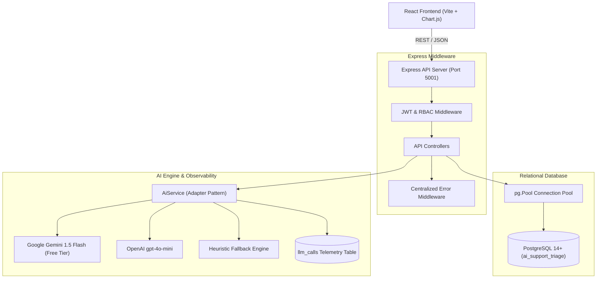

# AutoTriage AI — Intelligent Support Ticket Triage & Observability Platform

[](https://www.postgresql.org/)
[](https://nodejs.org/)
[](https://expressjs.com/)
[](https://react.dev/)
[](https://ai.google.dev/)
[](https://jwt.io/)

An end-to-end, enterprise-grade AI Support Ticket Triage platform built with **React**, **Node.js/Express**, **PostgreSQL**, and **Google Gemini / OpenAI**.

AutoTriage AI automates ticket classification, sentiment scoring, priority routing, draft reply generation with human-in-the-loop review, SLA timer tracking, real-time duplicate detection, and deep LLM observability.

---

## 📸 Platform Screenshots & UI Walkthrough

> **Tip**: Screenshots visually demonstrate the system's live features, responsive layout, and real-time triage controls.

| View | Description | Preview |
|---|---|---|
| **Operations Dashboard** | Live support metrics: open tickets, overdue SLA breaches, average resolution time, and AI draft approval rate. |  |
| **Searchable Ticket Queue** | Multi-criteria filtering (status, priority, category, assignee, overdue, duplicate) with full-text search and priority pulse badges. |  |
| **AI Triage & Review Engine** | Ticket detail view featuring automated category/priority predictions, confidence scoring, editable AI drafts (*Approve*, *Edit*, *Reject*), and thread summarization. |  |
| **LLM Run Debugger** | Observability dashboard logging model names, token consumption (prompt/completion/total), latency in milliseconds, and raw JSON request/response payloads. |  |
| **SQL Analytics & Leaderboard** | Category and priority breakdown charts (Chart.js), agent resolution leaderboard, and prompt version accuracy tracking. |  |
| **Customer Submission Portal** | Public ticket submission form with automated PostgreSQL trigram duplicate warning detection. |  |

---

## ✨ Key Features

### 1. 🤖 Intelligent AI Triage & Response Engine
- **Automated Classification**: Automatically predicts ticket category, priority (`urgent`, `high`, `medium`, `low`), and sentiment (`positive`, `neutral`, `negative`, `urgent`) with confidence percentages.
- **Human-in-the-Loop Review**: AI drafts are held in a `pending` state until an authorized agent reviews, edits, or approves them before sending.
- **Thread Summarization**: Automatically condenses multi-comment conversations into a 3-bullet executive summary (Root Problem, Actions Taken, Next Step).
- **Zero-Budget Heuristic Fallback**: Pluggable provider adapter supports **Google Gemini 1.5 Flash** (free tier with 15 RPM / 1,500 daily calls) and OpenAI `gpt-4o-mini`. If APIs hit rate limits (429) or timeouts, a deterministic in-memory heuristic NLP engine automatically takes over, guaranteeing 100% platform uptime.

### 2. 🔍 Real-Time Duplicate Ticket Detection
- **In-Database Trigram Similarity**: Pushes fuzzy string matching into the PostgreSQL engine using `pg_trgm` and GIN indexing on `subject gin_trgm_ops`.
- **Sub-5ms Matching**: Evaluates `similarity(subject, :query) > 0.45` against active tickets during ticket creation to immediately warn customers and agents of duplicate issues.

### 3. ⏰ SLA Timers & Overdue Alert Engine
- **Priority-Driven Deadlines**: Automated database triggers lookup resolution targets from `sla_policies` upon ticket creation and calculate `sla_due_at = created_at + policy_hours`.
- **Partial Index Optimization**: Queries for active overdue tickets are backed by a partial index `ON tickets(sla_due_at, is_overdue) WHERE status NOT IN ('resolved', 'closed')`, keeping the index small, cached in RAM, and sub-millisecond fast.

### 4. 🛠️ LLM Run Debugger & Observability
- Low-level telemetry table (`llm_calls`) tracks every API execution.
- Captures model name, latency (ms), prompt tokens, completion tokens, estimated USD cost, and raw JSON request/response payloads.
- Features an expandable JSON inspection drawer in the UI for inspecting model reasoning and fallback error traces.

### 5. 🔒 Role-Based Access Control (RBAC) & Audit Logging
- Passwords salted and hashed with `bcryptjs` (cost factor 10).
- Stateless JWT authentication with role enforcement (`admin` vs `agent`).
- Automated PostgreSQL audit trigger (`log_ticket_history`) records every change to `status`, `assigned_to`, and `priority`.
- Supports private agent-only internal notes (`is_internal_note = true`) that are hidden from external customer views.

---

## 🏗️ System Architecture



---

## 🗄️ Database Architecture (10 Relational Tables)

| Table | Purpose | Key Constraints & Indexes |
|---|---|---|
| `customers` | Customer profiles and company data | Unique email, indexed for lookup. |
| `employees` | Support agents and administrators | Role check (`admin`, `agent`), bcrypt hashes. |
| `categories` | Structured ticket taxonomy | Unique category names. |
| `sla_policies` | Target resolution windows by priority | Unique priority (`urgent`, `high`, `medium`, `low`). |
| `tickets` | Primary operational ticket record | Auto-generated number (`TIC-1001`), self-referencing duplicate foreign key. |
| `ticket_history` | Immutable audit log of state mutations | Auto-populated by PostgreSQL `BEFORE UPDATE` trigger. |
| `comments` | Multi-party conversational thread | Supports public customer messages and private internal notes. |
| `prompt_versions` | Version-controlled AI prompts | Model pinning, temperature tuning, rollback support. |
| `ai_responses` | Generated drafts and human decisions | Tracks review decisions (`pending`, `approved`, `edited`, `rejected`). |
| `llm_calls` | AI observability & debugging telemetry | JSONB request/response payloads, latency (ms), token metrics. |

---

## 🔌 API Reference

### Authentication (`/api/auth`)
- `POST /api/auth/login` — Authenticate employee and return signed JWT.
- `GET /api/auth/me` — Retrieve currently authenticated user profile.
- `GET /api/auth/employees` — List active support agents for ticket assignment dropdowns.
- `POST /api/auth/register` — Admin-only: Register a new support agent or administrator.

### Tickets (`/api/tickets`)
- `GET /api/tickets` — Search (FTS), filter, sort, and paginate tickets.
- `GET /api/tickets/:id` — Detailed ticket view with customer info, AI draft, thread, and audit history.
- `POST /api/tickets` — Create new ticket (runs trigram duplicate check and computes SLA deadline).
- `PATCH /api/tickets/:id` — Update status, priority, category, or assignment (triggers auto-audit log).
- `POST /api/tickets/:id/assign` — Assign or reassign ticket to an agent.
- `GET /api/tickets/:ticketId/comments` — Fetch conversation thread (filters out internal notes for non-staff).
- `POST /api/tickets/:ticketId/comments` — Post customer reply, public agent reply, or private internal note.
- `GET /api/tickets/:ticketId/history` — Fetch chronological state mutation history.

### AI Engine (`/api/ai`)
- `POST /api/ai/tickets/:ticketId/triage` — Trigger AI classification, sentiment analysis, and first reply generation.
- `POST /api/ai/responses/:id/review` — Human-in-the-loop review: Approve, Edit, or Reject AI drafts.
- `GET /api/ai/tickets/:ticketId/summarize` — Generate 3-bullet executive conversation summary.
- `GET /api/ai/debug/llm-calls` — Retrieve LLM observability telemetry logs with JSON payloads.
- `GET /api/ai/prompts` — List versioned prompts.

### Analytics (`/api/analytics`)
- `GET /api/analytics/overview` — High-level KPI metrics (open, overdue, avg resolution hours, AI acceptance rate).
- `GET /api/analytics/breakdown` — Category, priority, and status distributions for charts.
- `GET /api/analytics/employee-performance` — Agent leaderboard (tickets assigned, resolved, and avg resolution time).
- `GET /api/analytics/trends` — Daily and weekly volume trends.
- `GET /api/analytics/prompt-performance` — Acceptance and approval benchmarks by prompt version.

---

## 🚀 Quick Start Guide

### Prerequisites
- [Node.js](https://nodejs.org/) v18 or higher
- [PostgreSQL](https://www.postgresql.org/) 14 or higher running locally

### 1. Database Setup
```bash
# 1. Create the PostgreSQL database
createdb ai_support_triage

# 2. Configure environment variables
cp .env.example .env

# 3. Populate schema and seed data
node database/setup.js
```

### 2. Start the Backend API
```bash
cd backend
npm install
node src/server.js
# Backend API runs at http://localhost:5001
```

### 3. Start the React Frontend
```bash
cd frontend
npm install
npm run dev
# Frontend runs at http://localhost:3000 (proxies /api requests to :5001)
```

---

## 👥 Demo Staff Accounts

| Role | Email | Password | Access Level |
|---|---|---|---|
| **Administrator** | `admin@triage.local` | `Password123!` | Full admin access, staff registration, SLA management |
| **Support Agent** | `sarah.agent@triage.local` | `Password123!` | Ticket triage, AI review, comments, thread resolution |
| **Support Agent** | `david.agent@triage.local` | `Password123!` | Ticket triage, AI review, comments, thread resolution |

*(Quick one-click demo login buttons are also available directly on the login screen).*

---

## 📄 License
This project is open-source and available under the [MIT License](LICENSE).
