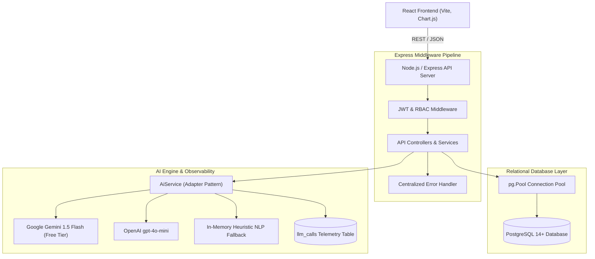

# AI Support Ticket Triage — Technical Architecture & System Specification

> **Repository**: https://github.com/thanujaa9/ai-support-ticket-triage  
> **Tech Stack**: React.js, Node.js, Express.js, PostgreSQL 14+, Google Gemini / OpenAI, Chart.js, Vite  

---

## 1. System Architecture Overview

The platform uses a layered client-server architecture designed for high availability, low-latency search, and resilient AI triage workflows:

---

## 2. Key Architecture Decisions & Technical Solutions

| Subsystem | Architectural Challenge | Engineering Solution |
|---|---|---|
| **Duplicate Ticket Detection** | Full-text comparison across tens of thousands of open records in application memory causes memory bloat and high network I/O ($O(N)$). | Leveraged PostgreSQL's native `pg_trgm` extension with a GIN index on `subject gin_trgm_ops`. Similarity checks (`similarity(subject, $1) > 0.45`) execute directly inside the database engine in under 5ms. |
| **Fault-Tolerant AI Orchestration** | Upstream AI APIs can encounter 429 rate limits, cold-start latency, or temporary downtime. | Implemented a provider adapter supporting Google Gemini 1.5 Flash and OpenAI `gpt-4o-mini`. Includes an automatic deterministic heuristic NLP engine that catches exceptions, triages tickets without downtime, and logs the fallback event in `llm_calls`. |
| **SLA Monitoring & Overdue Alerts** | Over 90% of tickets in support desks are resolved or closed; indexing historical tickets wastes memory. | Built a PostgreSQL **partial index** `WHERE status NOT IN ('resolved', 'closed')` on `(sla_due_at, is_overdue)`. The index remains small, memory-resident, and sub-millisecond fast. |
| **Audit Trails & Concurrency** | Tracking state changes (status, priority, assignee) without race conditions or lost history. | Handled state mutations via PostgreSQL triggers (`log_ticket_history`) and transactional queries (`BEGIN...COMMIT`), guaranteeing an immutable audit trail. |
| **Telemetry vs Domain Separation** | Storing AI telemetry (tokens, latency, prompt templates) inside the business ticket model pollutes domain boundaries. | Separated business state (`ai_responses`) from low-level system telemetry (`llm_calls` with JSONB payloads). |

---

## 3. Database Schema & Indexing Strategy

The database schema spans 10 relational tables:
- `customers`: Customer profiles and company associations.
- `employees`: Staff accounts with role constraints (`admin`, `agent`) and salted bcrypt password hashes.
- `categories`: Structured ticket taxonomy.
- `sla_policies`: Priority-based resolution and response targets in hours.
- `tickets`: Primary transactional records with status, priority, sentiment, and self-referencing duplicate relations.
- `ticket_history`: Immutable audit log populated via PostgreSQL triggers.
- `comments`: Unified conversation thread supporting customer replies, public agent replies, and `is_internal_note` staff-only notes.
- `prompt_versions`: Governance and versioning for AI prompts (`1.0.0`, `1.1.0`).
- `ai_responses`: Human-in-the-loop review table tracking proposed drafts, confidence scores, and agent approval decisions (`approved`, `edited`, `rejected`).
- `llm_calls`: Low-level observability table logging prompt tokens, completion tokens, latency (ms), cost, and raw request/response JSONB payloads.

### Performance Indexes
- **GIN Full-Text Search**: `to_tsvector('english', subject || ' ' || description)` for sub-millisecond keyword queries across tickets.
- **Trigram Similarity GIN Index**: `subject gin_trgm_ops` for real-time duplicate ticket candidate matching.
- **Partial SLA Index**: `(sla_due_at, is_overdue) WHERE status NOT IN ('resolved', 'closed')`.
- **Composite Index**: `(status, priority)` to optimize active queue filtering.

---

## 4. Security & Access Control Model

1. **Password Hashing**: Passwords hashed with `bcryptjs` using a salt work factor of 10.
2. **Stateless Authentication**: Issues HMAC-SHA256 signed JWT tokens with non-sensitive claims (`id`, `email`, `role`) and a 7-day expiration.
3. **Role-Based Access Control (RBAC)**: Higher-order Express middleware (`requireRole('admin')`) restricts privileged actions (staff registration, SLA policy modifications).
4. **Data Isolation**: Internal notes (`is_internal_note = true`) in the comments thread are filtered out by SQL queries when requests originate outside the authenticated staff portal.
